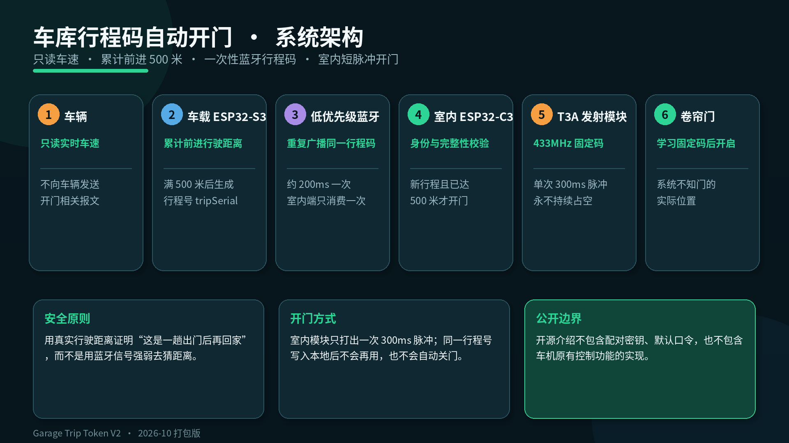
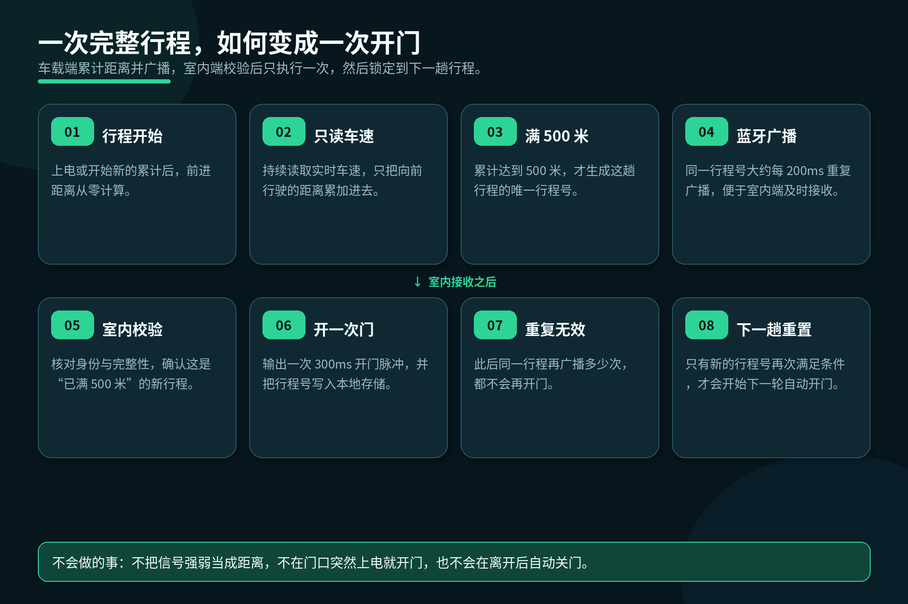
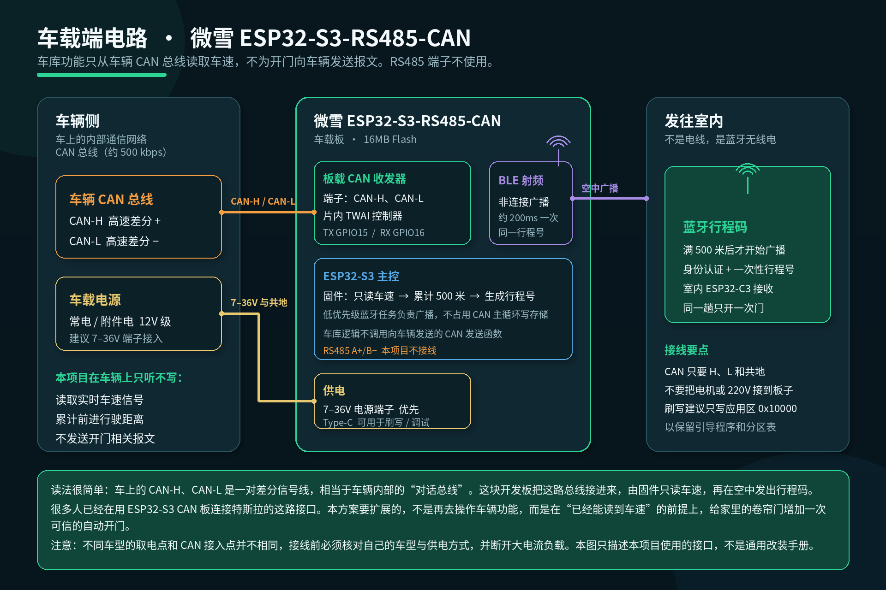
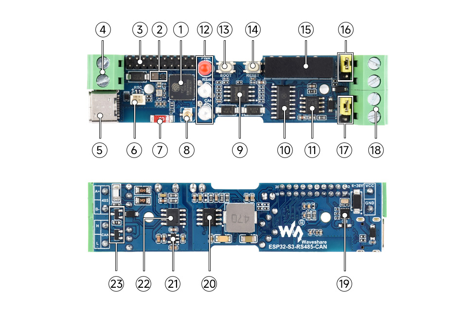
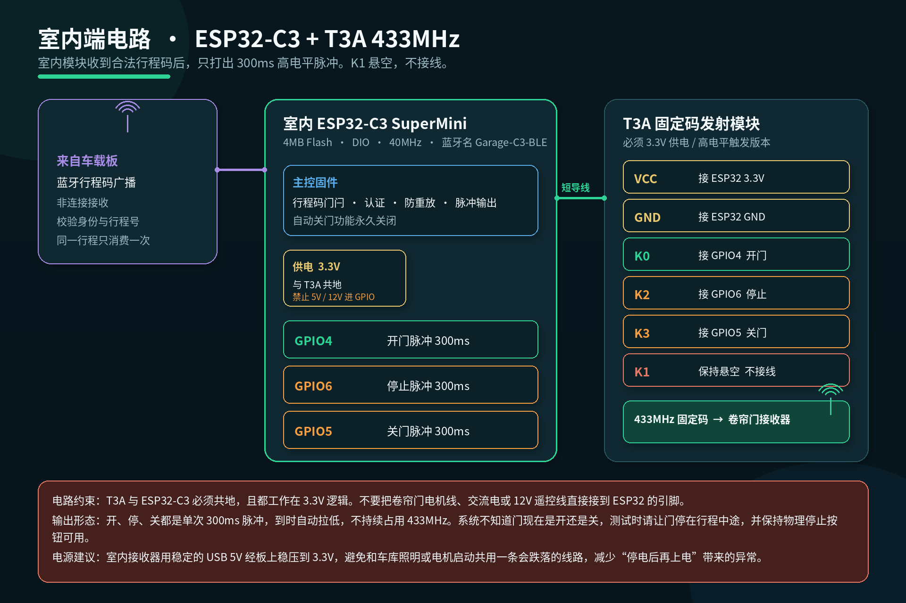
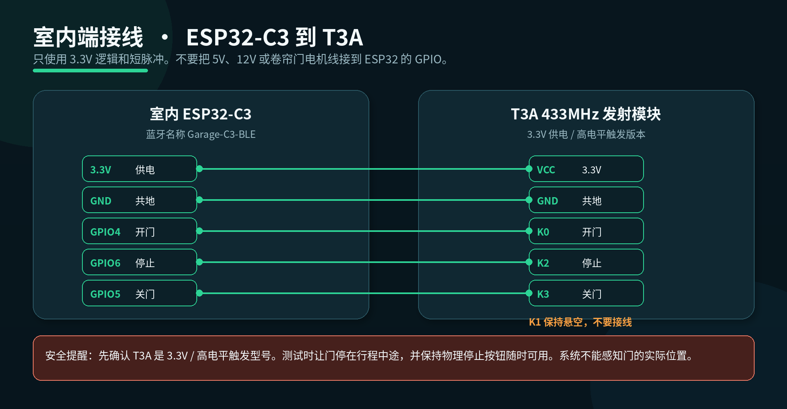

# Garage Trip Token

**Garage Trip Token V2**

Many owners already have an ESP32 board connected to the communication interface in a Tesla. The next question is this: can we add one more indoor Bluetooth module so the rolling garage door starts opening when the car is still about 20–30 metres away, and is clear by the time you turn in—without opening by mistake in the middle of the night?

[中文版 / Chinese version](README.md)

## Background: the in-car interface is already there

The modules inside a Tesla talk to each other over an internal network called the CAN bus. Think of it as the car’s private conversation line: the instrument cluster, the drive system, and the body controllers all exchange data on it. When you bring that bus outside the car, it usually appears as a differential pair named **CAN-H** and **CAN-L**.

In the last couple of years, many people have used ESP32 development boards with a CAN interface to attach to this bus. A common choice is the Waveshare **ESP32-S3-RS485-CAN**. The board already includes the CAN transceiver, the power terminals, and a Type-C port for flashing, so you do not have to design a car-communication board from scratch. For most users, the important part is not every register in the chip manual, but three practical questions:

1. Which high-speed CAN pair those CAN-H / CAN-L wires should join on the vehicle
2. Where the board should take 12 V-class power (this board accepts 7–36 V on its power terminals; Type-C is mainly for flashing and debugging)
3. What the firmware may read from that bus, and what it must not write

Once those three points are clear, the in-car interface is “connected.” Among the signals this board can read is real-time vehicle speed. That leads to a natural extension: **if the vehicle-side board already knows whether the car is moving, how fast it is going, and how far it has travelled, can it also authorize a trustworthy automatic opening of the rolling door at home?**

The experience we want is concrete. When the car is still about 20–30 metres from the garage, the door should start opening. By the time the nose of the car reaches the entrance, the door should already be clear enough to drive in. It should not depend on tapping a phone, and it should not throw away the car’s existing controls.

## Why current approaches open by mistake

A more common method is to decide that “the car is close” from a Bluetooth connection or from signal strength. It sounds direct, but it has three hard flaws.

First, Bluetooth signal strength is not a precise distance. Walls, the car body, people, and neighbouring radios all make the reading jump. You may think you are “20 metres away,” while the system has only seen a fluctuation.

Second, modules lose power, reboot, and come back online. If the indoor receiver treats a signal that reappears after a blink as a new approach, the door may open when it should not.

Third, and most worrying, are false triggers. A remote or a transmitter brought near the door, someone walking past at night, or a board that powers up in the doorway can all open the shutter. If the door opens while the car is still inside, that is not a small problem.

So this version does not try to “measure Bluetooth distance more accurately.” It changes the proof: **first prove that this was a real trip out and back, then allow the door to open once.** It does not try to sense “how many metres to the door,” and therefore will not open the door at midnight just because the signal jittered.

## How we open the door early, without opening it by mistake

Bluetooth itself usually has a range of tens of metres. When the car enters that range, the indoor module can hear the broadcast and the door can start opening early. That is exactly the “still 20–30 metres out, door already opening” experience.

But permission to open does not come from “the signal got stronger.” It comes from a one-time trip token:

- The vehicle-side board only reads real-time speed and accumulates forward travel
- Only after **500 metres** does it create a unique trip serial for this journey
- The same serial is re-broadcast about every 200 milliseconds so the doorway can catch it in time
- The indoor module checks identity and integrity, confirms this is a new trip that has already reached 500 metres, and then emits a single 300-millisecond pulse
- That serial is written to local storage, so further broadcasts of the same trip will not open the door again
- Automatic closing is permanently disabled; leaving the area at most re-arms the system for the next approach

The 500 metres is not a measurement of the last 20–30 metres to the door. It is a threshold that means “you really did drive away.” Nudging the car inside a compound, walking around the garage, or powering a board up suddenly cannot pass that threshold. When you actually drive back from outside, and Bluetooth is heard by the indoor module about 20–30 metres out, the door opens once.

## How the circuit is wired

The system has two ends. There is no control cable between them, only the Bluetooth trip token over the air.

### Vehicle side

The vehicle-side board is the Waveshare ESP32-S3-RS485-CAN. For this project it has only three relationships with the car:

- **CAN-H / CAN-L**: joined to the vehicle high-speed CAN, receive only
- **7–36 V power and common ground**: prefer the onboard power terminals
- **Type-C**: flashing and debugging; not required for the garage function itself

The RS485 A+ / B− terminals are left unconnected in this project. The garage-related Bluetooth broadcast uses the board’s built-in radio, so no extra wire needs to be run into the house.

The on-chip CAN controller is ESP32 TWAI: **GPIO15** for TX, **GPIO16** for RX, at about **500 kbps**. For opening the door, the firmware only reads speed and **does not send garage-related frames to the vehicle**.

*The board photograph is from the official [Waveshare ESP32-S3-RS485-CAN](https://www.waveshare.com/wiki/ESP32-S3-RS485-CAN) materials and is used only to identify the hardware. Power take-off points and CAN access points differ by vehicle. Confirm your own car and disconnect high-current loads before wiring. This diagram describes only the interfaces used in this project; it is not a general modification manual.*

### Indoor side

The indoor receiver is an ESP32-C3 SuperMini, advertising as `Garage-C3-BLE`. It does not drive the motor directly. It uses short pulses to trigger a T3A 433 MHz fixed-code transmitter, and the already-learned shutter receiver opens the door.

| ESP32-C3 | T3A | Function | Signal |
| --- | --- | --- | --- |
| 3.3V | VCC | Power | Must be 3.3 V |
| GND | GND | Ground | Must share ground |
| GPIO4 | K0 | Open | Single 300 ms active-high pulse |
| GPIO6 | K2 | Stop | Single 300 ms active-high pulse |
| GPIO5 | K3 | Close | Single 300 ms active-high pulse |
| — | K1 | Unused | Leave unconnected |

Use only a **3.3 V, active-high** T3A. Never feed 5 V, 12 V, mains, or motor wires into ESP32 GPIOs. Give the indoor module a stable USB supply, and avoid sharing a rail that sags when the motor or garage lights start. During testing, stop the door mid-travel and keep the physical stop button ready—the system cannot sense the door’s actual position.

A simpler wiring map is below:

## What the firmware does

There are two independent firmwares, one for the vehicle board and one for the indoor board. They cooperate only through an authenticated Bluetooth trip token. They do not share Wi-Fi, and a phone is not used as the automatic-open switch.

### Vehicle firmware (ESP32-S3)

The vehicle firmware is built around four jobs:

1. **Read speed only.** A CAN filter receives the vehicle’s real-time speed signal and decodes the current speed.
2. **Accumulate forward distance.** Only forward travel is added. Reverse or standstill does not increase a valid trip. After 500 metres (counted internally in millimetres, threshold 500000), the trip is marked qualified.
3. **Create a one-time trip serial.** Only a qualified trip gets a `tripSerial`, together with a “already reached 500 metres” flag. The same serial may be broadcast repeatedly, but it still means this one trip.
4. **Advertise on a low-priority Bluetooth task.** The same token is sent about every 200 ms. Storage writes stay in this low-priority task so they do not interrupt the CAN-reading loop.

For the garage function, the vehicle firmware does not call the interface that transmits frames to the car, and it does not rewrite other in-vehicle control logic in order to open the door. This public write-up covers only the trip-token mechanism above.

### Indoor firmware (ESP32-C3)

The heart of the indoor firmware is not “how many metres are you from the door,” but a trip-token gate:

1. **Receive and validate.** Only trip packets with the correct identity, a passing integrity check, and anti-replay protection are accepted. The older “open when the signal rises from weak to strong” method cannot automatically open the door in this version.
2. **Require the 500-metre flag.** The packet must say the trip has already accumulated 500 metres. A strong signal alone will not open the door.
3. **Act only on a new trip.** The serial is written to local storage before the open pulse is issued. If the same serial arrives again, only the first time counts.
4. **Short pulse outputs.** GPIO4, GPIO6, and GPIO5 correspond to open, stop, and close. Each is a single 300 ms pulse that returns low on its own.
5. **Automatic close stays off.** Leaving does not close the door; at most it re-arms the system for the next approach.
6. **Manual control remains.** You can still open, stop, and close manually, and you can still teach a fixed code. A phone or computer is not required for automatic opening.

If the vehicle board has not yet been upgraded to this trip-token version, automatic opening on the indoor side stays safely inactive. Manual open, stop, and close still work.

### Build and flash

- Indoor board: PlatformIO environment `home_ble_production`, 4 MB flash, DIO, 40 MHz. Write a full image at address `0x0`. To update only the application, write it at `0x10000` so stored trip serials and pairing data are kept. A full-image write will erase that information.
- Vehicle board: 16 MB flash. Prefer writing the application at `0x10000` so the existing bootloader, partition table, and stored data remain. Write the full 16 MB image at `0x0` only for a blank board or a complete restore.
- Back up before flashing. After flashing, verify the written digest; file size alone is not proof.
- After changing detection logic or GPIO mapping, run the host tests first: scenario guards, distance boundaries, no output path for automatic close, and every T3A action returning to the inactive state.

### How far this release has been verified

Trip Token V2, packaged on 25–26 October 2026, is the latest release of this design. At that time the following were done: source and protocol guard tests, distance-boundary tests, writing and verifying the indoor board and the vehicle application partition, and discovery plus connection of `Garage-C3-BLE` from a Mac.

What had not been finished, and therefore must not be described as “ready for daily use,” was in-the-loop confirmation of the over-the-air Bluetooth broadcast, and stationary or low-speed on-vehicle verification of the real speed signal and the 500-metre accumulation. If you reproduce the system, treat those two items as required acceptance tests before going live.

## Safety boundaries

- One trip opens the door only once; repeated broadcasts do nothing
- Bluetooth signal strength is not treated as distance
- Powering up next to the door does not open it automatically
- Automatic close is permanently disabled
- Every actuation is a 300 ms pulse; the 433 MHz transmitter is never held on
- The system cannot sense the door’s physical position, so a physical stop control must remain available
- Pairing keys, default passwords, and phone pairing codes are not included in this repository; each pair of boards should use keys you generate yourself

## What this repository publishes, and what it does not

This public package covers the background, mechanism, circuits, and firmware behaviour of a home rolling-door opener.

**Published:** the background and problem statement, system architecture, vehicle and indoor circuits, firmware behaviour, wiring, safety boundaries, and the current verification status.

**Not published:** pairing keys and passwords, and implementations of in-vehicle control functions that are unrelated to the garage door.

## Licence and disclaimer

This documentation and the project diagrams (except the official Waveshare hardware photograph) are intended to be released under [CC BY 4.0](https://creativecommons.org/licenses/by/4.0/). Rights in the Waveshare board photograph remain with the manufacturer. A licence for the firmware source will be declared separately once the publishable code set is confirmed.

This is a personal prototype for research into automating one home garage. Anyone who reproduces, installs, or connects it to a vehicle must assess electrical safety, radio compliance, and vehicle-interface risk, and must always keep a physical stop control available. Wiring must not be copied blindly from one car to another. The author is not liable for accidental opening, injury, equipment damage, or vehicle issues.
