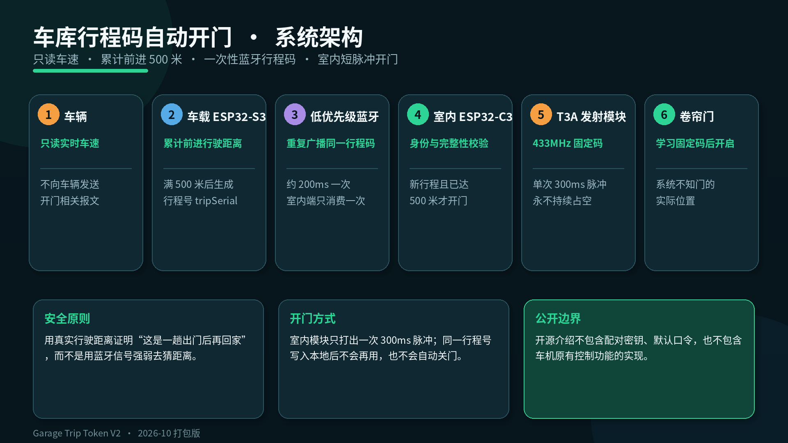
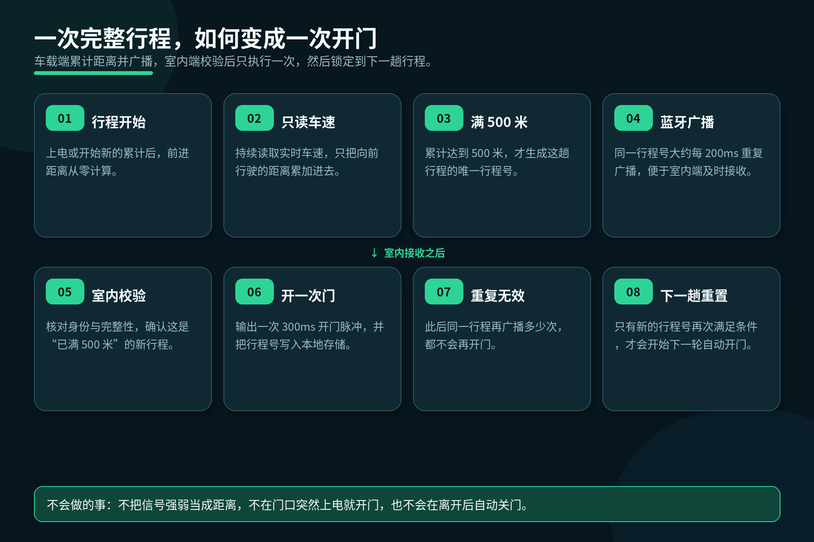
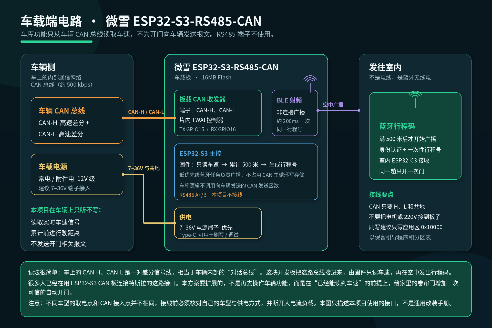
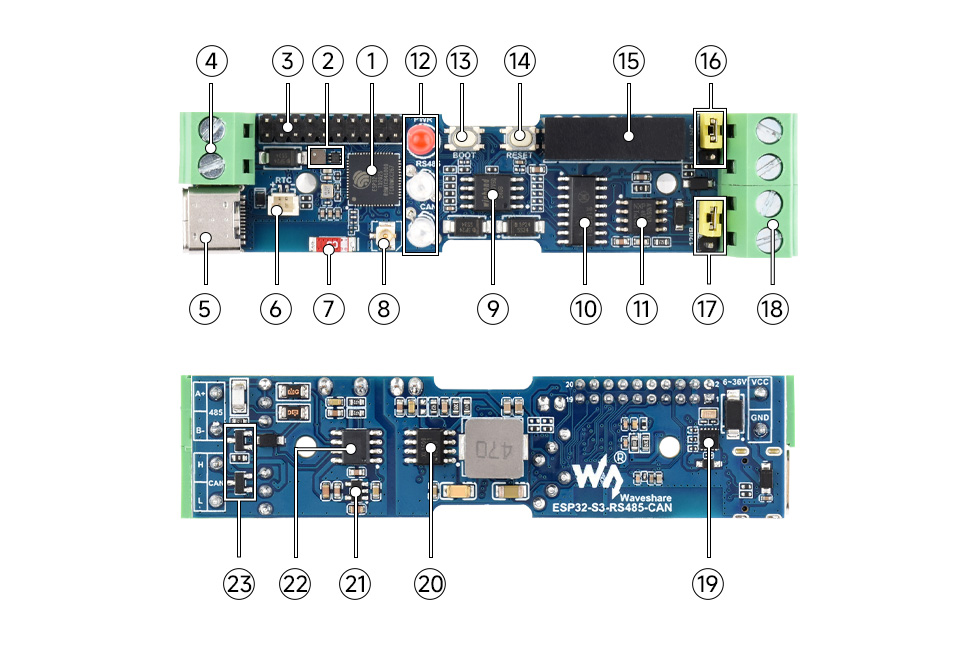
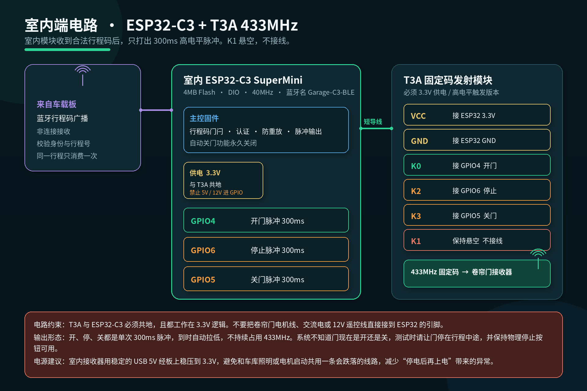
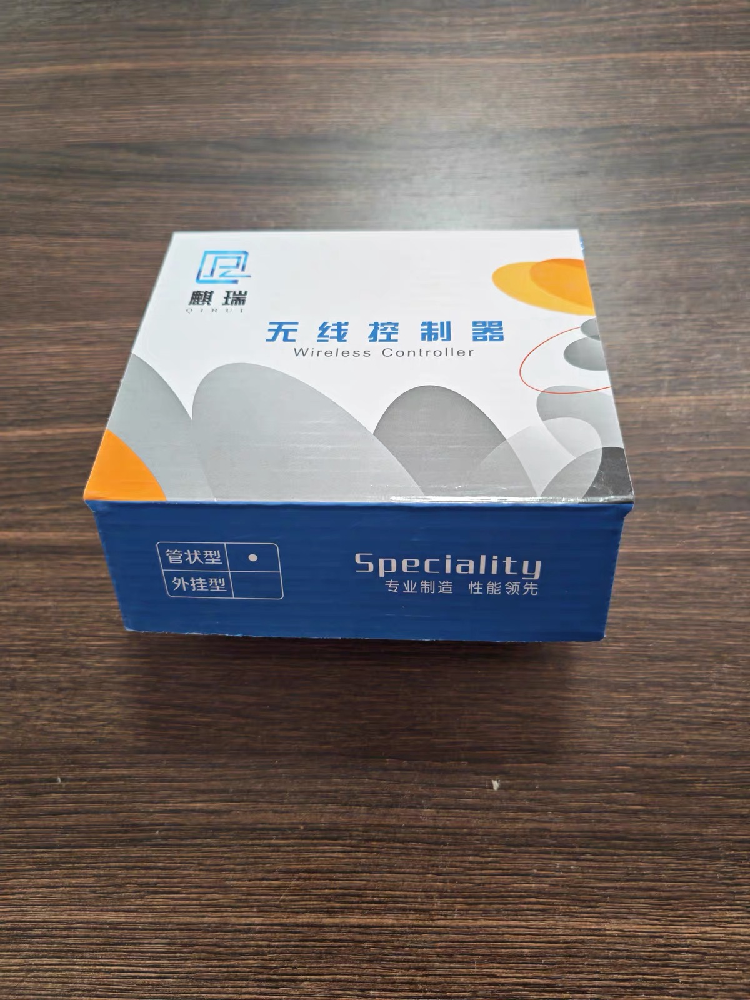
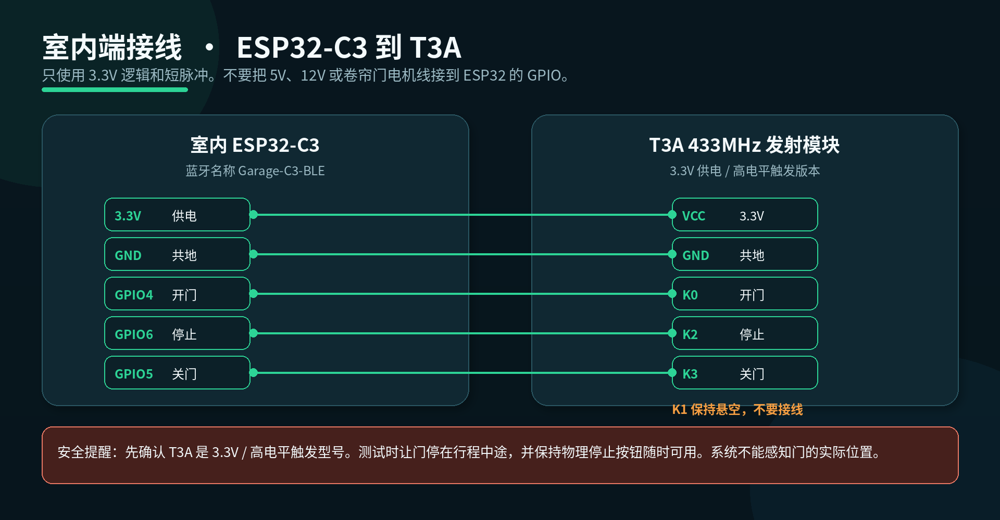

# 车库行程码自动开门

**Garage Trip Token V2**

很多车主已经用 ESP32 把特斯拉车上的通信接口接好了。我们要问的下一句话是：能不能再加一块室内蓝牙模块，让卷帘门在车还有二三十米时就开始打开，开到门口正好把车开进去——而且还不会在半夜误开。

[English version](README.en.md)

## 背景：车上的接口其实已经在了

特斯拉车里各模块之间，靠的是一路叫做 CAN 总线的内部通信网络。你可以把它理解成车上的“对话线”：仪表、驱动、车身控制，都在这上面交换数据。对外接线时，它通常以两根差分线出现，分别叫做 **CAN-H** 和 **CAN-L**。

近两年，很多人会用带 CAN 接口的 ESP32 开发板去接这路总线，其中很常见的一块就是微雪（Waveshare）的 **ESP32-S3-RS485-CAN**。板上已经把 CAN 收发器、电源端子、Type-C 调试口都做完了，并不需要自己从零画一张汽车通信板。对大多数使用者来说，真正要搞清楚的不是芯片手册里每一个寄存器，而是三件事：

1. 这两根 CAN-H / CAN-L 接到车辆的哪一路高速总线上
2. 板子从哪里取 12V 级电源（本板支持 7–36V 端子，Type-C 主要用于刷写和调试）
3. 固件从这条总线里读什么、不写什么

把这三件事说清楚，车上的接口就算“接上了”。这块板子能够读到的信号里，包括实时车速。于是一个很自然的扩展出现了：**既然车载板上已经能读到车在不在动、开了多快、走了多远，能不能再给家里的卷帘门加一个可信的自动开门？**

我们希望的体验很具体：车离车库门大概还有二三十米时，门就开始打开；等到车头转到门口，门已经往前开到位，可以直接把车开进去。不依赖手机点一下，也不要把原车的控制习惯全部改掉。

## 现有方案为什么容易误开

现在更常见的做法，是用蓝牙连接或信号强弱来判断“车靠近了”。听起来直接，实际有三个硬伤。

第一，蓝牙信号强弱不是精确距离。墙、车身、人体、隔壁的无线设备，都会让信号跳上跳下。你以为是“还差 20 米”，系统看到的可能只是一次波动。

第二，模块会停电、会重启、会重新上电。电源一闪，蓝牙一重连，门口的接收器如果把“重新出现的信号”当成一次新的靠近，门就可能在不该开的时候打开。

第三，也是最让人不放心的：误触。遥控器或发射模块被拿到附近、有人半夜在门外走过、设备在门口上电，都可能把卷帘门打开。门开了，车还在里面，这不是小问题。

所以，这一版要解决的不是“再把蓝牙距离测准一点”，而是换一种证明方式：**先证明这是一趟真正开出去又开回来的行程，再允许开一次门。** 不是探测“现在离门几米”，因此也不会因为信号抖动，就在半夜把你的门打开。

## 我们怎么实现“提前开门，但不误开”

蓝牙本身通常有几十米的到达范围。当车驶入这个范围，室内模块听得到广播，门就可以提前打开——这正好覆盖“还差二三十米、门先打开”的体验。

但开门许可不来自“信号变强了”，而来自一枚一次性的行程码：

- 车载板只读取实时车速，并把向前行驶的距离累加起来
- 累计达到 **500 米**，才生成这趟行程的唯一行程号
- 同一行程号大约每 200 毫秒重复广播一次，方便门口及时收到
- 室内模块校验身份和完整性，确认这是“已满 500 米”的新行程后，只打出一次 300 毫秒脉冲
- 这个行程号会写入本地存储，再广播多少次也不会再开
- 自动关门永久关闭；离开最多只是为下一趟重新布防

500 米不是门口那二三十米的距离测量，而是一道“你确实出门行驶过”的门槛。在小区里挪一下车、在车库边走动、设备突然上电，都跨不过这道门槛。等你真正从外面开回来，蓝牙在二三十米外被室内模块收到时，门才开一次。

## 电路怎么接

系统分成两端，中间没有控制电线，只有空中的蓝牙行程码。

### 车载端

车载板使用微雪 ESP32-S3-RS485-CAN。和车辆之间，本项目只用三组关系：

- **CAN-H / CAN-L**：接到车辆高速 CAN，只接收
- **7–36V 电源与共地**：优先用板载电源端子取电
- **Type-C**：刷写和调试，不作为车库功能的必要接线

板上的 RS485 A+ / B− 端子，本项目不接线。车库相关的蓝牙广播由板载射频完成，不需要再拉一根线到屋里。

片内 CAN 控制器使用 ESP32 的 TWAI：发送脚 **GPIO15**，接收脚 **GPIO16**，总线速率约 **500 kbps**。需要强调的是：就开门这件事而言，固件只读车速，**不向车辆发送开门相关报文**。

*开发板外观照片来自 [Waveshare ESP32-S3-RS485-CAN](https://www.waveshare.com/wiki/ESP32-S3-RS485-CAN) 官方资料，仅用于说明硬件型号。不同车型的取电点和 CAN 接入点并不相同，接线前必须核对你自己的车型，并断开大电流负载。本图只描述本项目使用的接口，不是通用改装手册。*

### 室内端

室内接收器是一块 ESP32-C3 SuperMini，蓝牙名称为 `Garage-C3-BLE`。它不直接驱动电机，而是用短脉冲去触发 T3A 433MHz 固定码发射模块，再由已经学习过的卷帘门接收器开门。

| ESP32-C3 | T3A | 功能 | 形态 |
| --- | --- | --- | --- |
| 3.3V | VCC | 供电 | 必须 3.3V |
| GND | GND | 共地 | 必须共地 |
| GPIO4 | K0 | 开门 | 单次 300ms 高电平脉冲 |
| GPIO6 | K2 | 停止 | 单次 300ms 高电平脉冲 |
| GPIO5 | K3 | 关门 | 单次 300ms 高电平脉冲 |
| — | K1 | 不用 | 保持悬空 |

请只使用 **3.3V 供电、高电平触发** 的 T3A。不要把 5V、12V、交流电或卷帘门电机线接到 ESP32 的 GPIO。室内模块建议用稳定的 USB 供电，尽量不要和电机启动、车库照明共用一条会瞬间跌落的线路。测试时让门停在行程中途，并保持物理停止按钮随时可用——因为系统并不能感知门的实际位置。

更简洁的接线对照，见下图：

## 固件写了什么

系统有两套独立固件，分别烧录到车载板和室内板。它们只通过认证后的蓝牙行程码协作，不共享 Wi-Fi，也不把手机当作开门开关。

### 车载固件（ESP32-S3）

车载固件围绕四件事展开：

1. **只读车速**：在 CAN 过滤器中精确接收车辆的实时车速信号，解码后得到当前速度。
2. **累计前进距离**：只把向前行驶的距离累加；倒车或静止不增加有效行程。累计达到 500 米（内部按毫米计，阈值 500000）后，这趟行程才算“合格”。
3. **生成一次性行程号**：合格后才生成 `tripSerial`，并带上“已满 500 米”的标志。同一行程号会反复广播，但含义始终是这一趟。
4. **低优先级蓝牙任务广播**：大约每 200ms 重复发出同一枚行程码。存储写入只放在这个低优先级任务里，避免打断 CAN 读取主循环。

就车库功能而言，车载固件不调用向车辆发送报文的接口，也不会因为要开门，去改写车上的其他控制逻辑。公开介绍只覆盖上述行程码机制。

### 室内固件（ESP32-C3）

室内固件的核心不是“测你离门多远”，而是一道行程码门闩：

1. **接收并校验**：只接受身份正确、完整性校验通过、带有防重放保护的行程包。旧的“信号由弱变强再开门”方案，在这一版里不能再自动开门。
2. **500 米合格标志**：包里必须带着“累计行驶已达 500 米”的标志，否则即使信号再强也不开。
3. **新行程才执行**：行程号在开门脉冲发出前写入本地存储。同一个行程号反复到达，只会在第一次生效。
4. **短脉冲输出**：GPIO4 / GPIO6 / GPIO5 分别对应开、停、关，全部是单次 300ms 脉冲，到时自动拉低。
5. **自动关门永久关闭**：离开不会关上门；最多为下一次接近重新布防。
6. **手动能力保留**：仍然可以手动开门、立即停止、手动关门，以及做固定码学习。手机或电脑不是自动开门的必要条件。

车载板如果还没有升级到这一版行程码，室内端的自动开门会安全地保持不触发，手动开、停、关仍可使用。

### 构建与刷写

- 室内板：PlatformIO 环境 `home_ble_production`，4MB Flash，DIO，40MHz。完整镜像从地址 `0x0` 写入；只更新程序时，可将应用写到 `0x10000`，以免清掉本地已记录的行程号和配对信息。全量写入会清除这些信息。
- 车载板：16MB Flash。建议将应用写到 `0x10000`，保留现有引导程序、分区表和已有存储。完整 16MB 镜像从 `0x0` 写入，只用于空白板或整板恢复。
- 刷写前应备份；刷写后应核对写入摘要，而不是只看文件大小。
- 变更检测逻辑或 GPIO 映射后，应先跑宿主测试：场景守卫、距离边界、自动关门没有输出路径、每个 T3A 动作都会回到拉低状态。

### 这一版验证到哪一步

2026 年 10 月 25 日至 26 日打包的 Trip Token V2，是目前这一方案的最后发行档。当时已经完成：源码与协议守卫测试、距离边界测试、室内板与车载应用区写入及校验，以及 Mac 发现并连接 `Garage-C3-BLE`。

当时尚未完成、因此不能写成“已经日常可用”的，是空中蓝牙广播的在环确认，以及实车车速信号与累计 500 米的静止 / 低速装车验证。复现时，请把这两项当作上线前的必做验收。

## 安全边界

- 一次行程只开一次门，重复广播无效
- 不把蓝牙信号强弱当成距离
- 门口突然上电不会自动开门
- 自动关门永久关闭
- 每个动作都是 300ms 脉冲，不持续占用 433MHz
- 系统不能感知门的物理位置，必须保留物理停止手段
- 配对密钥、默认口令和手机配对码不进入本仓库；每套板子应使用自己生成的密钥

## 本仓库公开什么，不公开什么

本次公开的是家用车库自动开门的背景、机制、电路和固件说明。

**会公开**：背景与问题定义、系统架构、车载 / 室内电路、固件行为、接线、安全边界和当前验证状态。

**不会公开**：配对密钥与口令、以及和车库无关的车机原有控制功能实现。

## 许可与免责

本文档与项目配图（Waveshare 官方硬件照片除外）拟采用 [CC BY 4.0](https://creativecommons.org/licenses/by/4.0/)。Waveshare 开发板图片的权利仍归原厂商。固件源码的许可证，将在确认可公开的代码范围后单独声明。

这是一套个人项目原型，用于自己的车库自动化研究。任何仿制、安装和车辆接入，都需要你自行评估电气安全、无线电合规和车辆接口风险，并始终保留物理停止手段。不同车型的接线不能照搬。作者不对误开门、夹伤、设备损坏或车辆问题承担责任。
